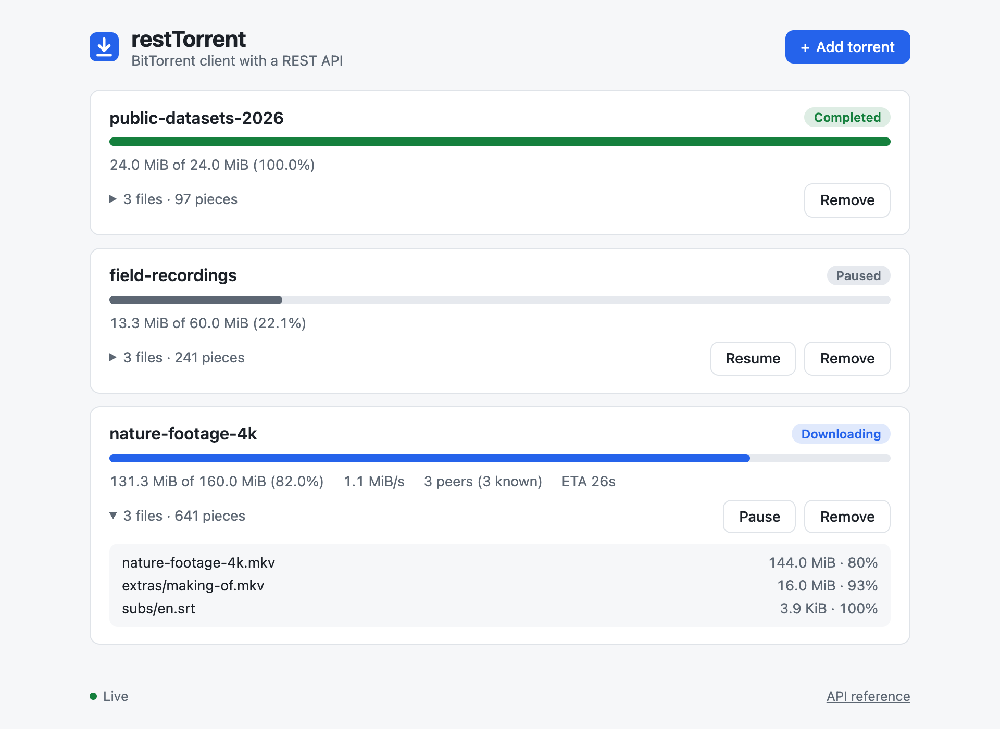
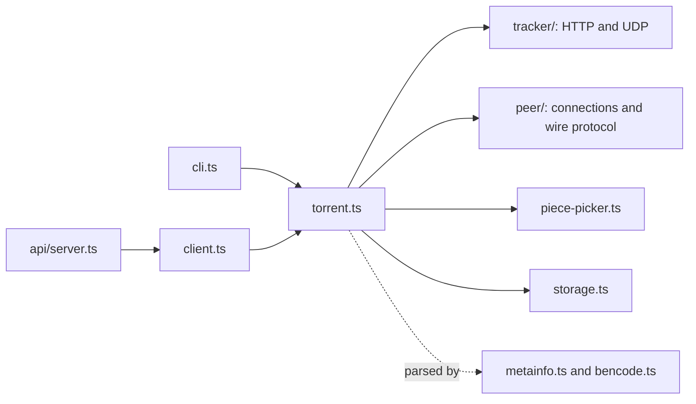

# restTorrent

[](https://github.com/MSJawad/restTorrent/actions/workflows/ci.yml)

A BitTorrent client written from scratch in TypeScript, with a REST API and a small web page for
managing downloads. It has no runtime dependencies: bencode, the tracker protocols and the peer
wire protocol are all implemented here on top of Node's standard library.


<sub>The CLI downloading [Sintel](https://durian.blender.org/) (Blender Foundation,
CC BY 3.0) from real peers. The download itself is shown at 6x speed.</sub>

## Features

- **Torrent files**: single- and multi-file torrents, BEP 12 multi-tracker lists, info hash
  computed over the original bytes. Path components are validated so a torrent cannot write
  outside the download directory.
- **Trackers**: HTTP ([BEP 3](https://www.bittorrent.org/beps/bep_0003.html)) and UDP
  ([BEP 15](https://www.bittorrent.org/beps/bep_0015.html)), compact IPv4 and IPv6 peer lists,
  timeouts with retries, all tiers announced in parallel, periodic re-announce.
- **Peer wire protocol**: handshake, bitfield/have, choke/interested, 32 pipelined 16 KiB block
  requests per peer, request timeouts, keep-alives, and up to 40 peers at once.
- **Piece selection**: rarest first, finishing pieces already in progress before starting new
  ones, with an endgame mode that races the last blocks across peers and cancels the duplicates.
- **Integrity**: every piece is checked against its SHA-1 hash before it is written. Corrupt
  pieces are thrown away and fetched again, and peers that keep sending bad data are banned.
- **Resume**: on start, the data already on disk is re-hashed, so an interrupted download
  continues where it stopped without trusting any saved state.
- **REST API** with server-sent events, plus a progress page. The server remembers its torrents
  across restarts.

### Not supported

restTorrent only downloads. It does not upload to other peers or accept incoming connections, so
it is a polite leecher rather than a full swarm member. Magnet links and DHT, uTP, peer exchange
and protocol encryption are not implemented.

## Getting started

You need [Node.js](https://nodejs.org/) 24 or newer.

```sh
git clone https://github.com/MSJawad/restTorrent.git
cd restTorrent
npm ci
npm run build
npm link        # optional: puts `resttorrent` on your PATH
```

Without `npm link`, run `node dist/cli.js` wherever these examples say `resttorrent`.

### Command line

```sh
resttorrent info sintel.torrent                     # what is in a .torrent file
resttorrent download sintel.torrent --out downloads # download it, with a progress bar
```

Run the same `download` command again after an interruption, and it resumes. Set
`NODE_DEBUG=resttorrent` to trace tracker replies and peer connections.

### Server and web page

```sh
resttorrent serve --port 9080 --dir downloads
```

Then open <http://127.0.0.1:9080> to add `.torrent` files (with the button or by dropping them
onto the page), watch progress, and pause, resume or remove torrents.

<picture>
  <source media="(prefers-color-scheme: dark)" srcset="docs/web-ui-dark.png">
  
</picture>

The server listens on 127.0.0.1 by default. The API has no authentication, and anyone who can
reach it can make it write files into the download directory, so only use `--host` to expose it
on a network you trust.

## REST API

The full schema is in [docs/openapi.yaml](docs/openapi.yaml). Torrents are identified by their
info hash (40 hex characters).

| Method   | Path                          | Description                                                                         |
| -------- | ----------------------------- | ----------------------------------------------------------------------------------- |
| `GET`    | `/api/torrents`               | List torrents with their progress.                                                  |
| `POST`   | `/api/torrents`               | Add a torrent. The body is the `.torrent` file. Add `?paused=true` to add it paused. |
| `GET`    | `/api/torrents/{id}`          | One torrent's progress: pieces, bytes, peers, speed, ETA and per-file progress.     |
| `POST`   | `/api/torrents/{id}/pause`    | Pause downloading.                                                                  |
| `POST`   | `/api/torrents/{id}/resume`   | Resume, or retry a torrent in the `error` state.                                    |
| `DELETE` | `/api/torrents/{id}`          | Remove the torrent. Add `?deleteFiles=true` to delete its files too.                |
| `GET`    | `/api/events`                 | Server-sent events: a `torrents` event with the full list once a second.            |

Errors come back as `{"error": "..."}` with a matching status: 400 for an invalid torrent, 404
for an unknown id, 409 for a duplicate or an action that does not apply (pausing a completed
torrent), 413 for files over 10 MiB, and 415 for a wrong `Content-Type`.

```sh
$ curl -s --data-binary @sintel.torrent -H 'Content-Type: application/x-bittorrent' \
    http://127.0.0.1:9080/api/torrents
$ curl -s http://127.0.0.1:9080/api/torrents/08ada5a7a6183aae1e09d831df6748d566095a10
{
  "id": "08ada5a7a6183aae1e09d831df6748d566095a10",
  "name": "Sintel",
  "state": "downloading",
  "error": null,
  "size": 129302391,
  "downloaded": 45613056,
  "progress": 0.3527626646904,
  "pieces": { "total": 987, "have": 348, "checked": 987 },
  "corruptPieces": 0,
  "peers": { "connected": 9, "known": 74 },
  "downloadSpeed": 1363148,
  "eta": 62,
  "tracker": {
    "lastAnnounce": "2026-10-26T02:54:13.418Z",
    "lastError": null,
    "peersReturned": 50
  },
  "files": [
    { "path": "Sintel/Sintel.mp4", "size": 129241752, "downloaded": 45605172 },
    ...
  ],
  "fileCount": 11,
  "addedAt": "2026-10-26T02:54:12.904Z"
}
$ curl -s -X POST http://127.0.0.1:9080/api/torrents/08ada5a7a6183aae1e09d831df6748d566095a10/pause
$ curl -N http://127.0.0.1:9080/api/events
```

## How it works



| Module | Responsibility |
| --- | --- |
| `bencode.ts` | Bencode encoder and decoder. Byte strings stay Buffers, because torrents mix text with binary hashes. |
| `metainfo.ts` | Validates a `.torrent`, lays its files out end to end, and hashes the raw `info` bytes. |
| `tracker/` | HTTP and UDP announces. `TrackerList` applies the BEP 12 tier rules. |
| `peer/protocol.ts` | Message encoding, plus a streaming reader that splits TCP data into messages however it is chunked. |
| `peer/connection.ts` | One peer: handshake, choke and interest state, timeouts, and typed events. |
| `piece-picker.ts` | Which blocks to request from which peer: rarest first, then endgame. Pure logic, unit tested. |
| `storage.ts` | Maps pieces onto file offsets (one piece can span several files), and re-verifies data on disk. |
| `torrent.ts` | One download. Announces, keeps peers busy, verifies and writes pieces, and tracks progress. |
| `client.ts` | Several torrents for the server, remembered in `<dir>/.resttorrent/` across restarts. |
| `api/server.ts` | The REST API, server-sent events and the static page in `public/`, on plain `node:http`. |

A download goes like this. `Torrent.start()` re-hashes whatever is already on disk, then announces
to every tracker tier at once and connects to the peers that come back. When a peer says it has
pieces we need, we send `interested`; once it unchokes us, the picker fills that peer's pipeline
with block requests. Blocks are assembled in memory. When a piece is complete, its SHA-1 hash is
checked, it is written to the right offsets of the right files, and a `have` goes out to every
peer. Requests from peers that choke us, disconnect or time out go back into the pool for others.

## Tests

```sh
npm test          # unit and in-process integration tests (about 3 seconds)
npm run lint
npm run typecheck
npm run test:e2e  # end-to-end test, needs Docker
```

- **Unit tests** cover bencode, metainfo parsing (including path traversal), tracker request and
  response encoding, the piece-to-file mapping, the wire protocol reader, and the piece picker.
- **Integration tests** run real downloads on 127.0.0.1 against in-process seeders and a fake
  tracker: a multi-file torrent from two seeders, a peer that sends corrupt data, resuming a
  partial download, pausing, the CLI as a child process, and the whole REST API.
- **End-to-end test** ([test/e2e/run.sh](test/e2e/run.sh)) starts
  [opentracker](https://erdgeist.org/arts/software/opentracker/) and a
  [Transmission](https://transmissionbt.com/) seed in Docker, has Transmission create a multi-file
  torrent, downloads it with restTorrent over both the HTTP and the UDP tracker protocol, compares
  every byte with the original, and then checks that a deleted file is fetched again on resume.
  Everything stays on a private Docker network.

CI runs all of these on every pull request and on every push to master.

## History and credits

This started in 2019 as a learning project following Allen Kim's tutorial
[How to make your own bittorrent client](https://allenkim67.github.io/programming/2016/05/04/how-to-make-your-own-bittorrent-client.html)
([allenkim67/allen-torrent](https://github.com/allenkim67/allen-torrent)). That early version got
as far as parsing a `.torrent` and sending a UDP announce. It has since been rewritten in
TypeScript as the complete client described above, with the REST API the name promised, but the
tutorial is where it began and is well worth reading.

## License

[MIT](LICENSE)
